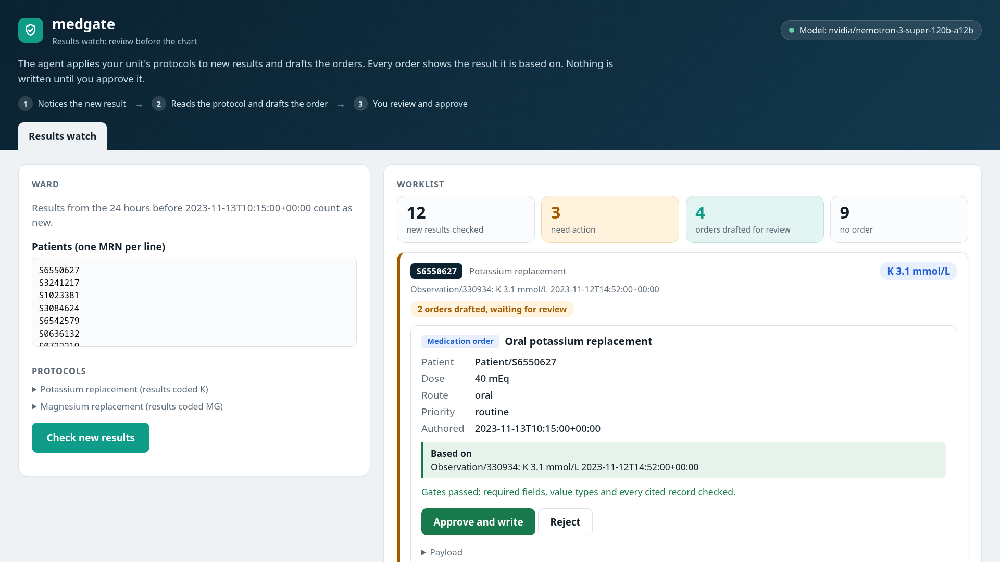
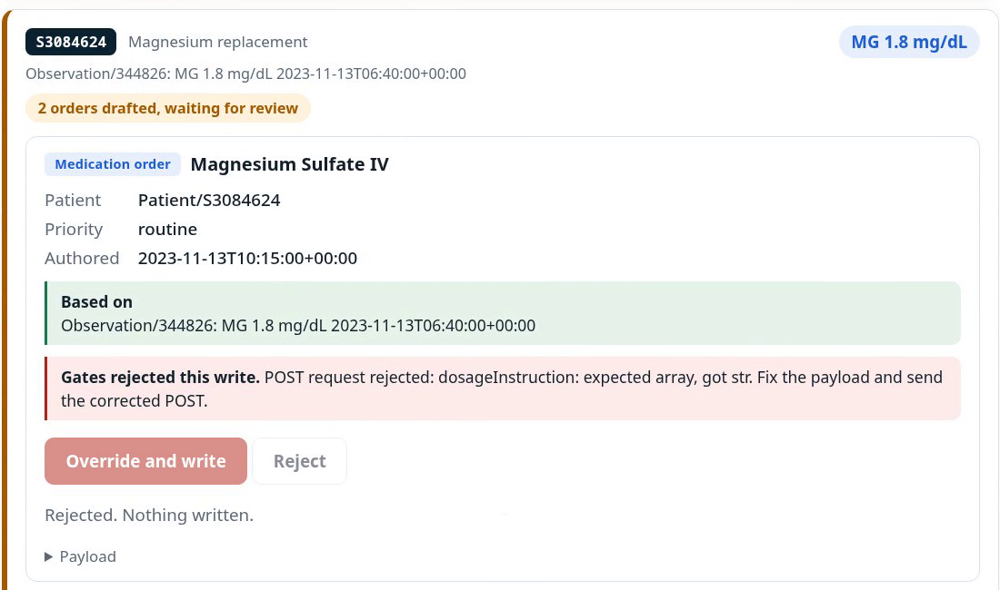
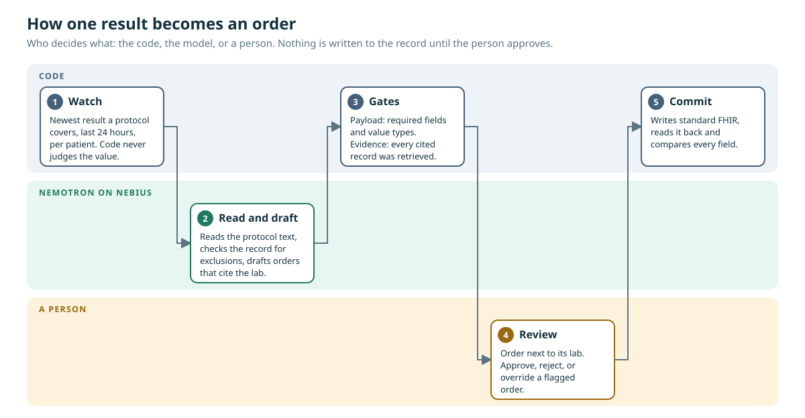

<p align="center">
  
</p>

<p align="center">
  <a href="LICENSE"></a>
  
  
  
</p>

A results watch for the hospital record. When a new lab result arrives, an agent applies the unit's protocol to it and drafts the orders the protocol calls for, each citing the result it is based on. Nothing is written to the record until a clinician approves the order on a review screen. Built on [MedAgentBench](https://github.com/stanfordmlgroup/MedAgentBench)'s FHIR server and graded by the benchmark's own grader.

Why: abnormal results get acted on late or not at all. A systematic review found 6.8% to 62% of laboratory tests were never followed up, and even with a nurse-driven protocol one ward took 112 minutes from result to dose. Sources, and which numbers were checked on the primary page, are in [docs/PAIN.md](docs/PAIN.md). Protocols help a great deal; they still wait for someone to notice the result and build the order.

This runs on the benchmark's synthetic patients. It makes no clinical claims and is not for use with real patient data.

## See it

<p align="center">
  
</p>

A scan of the demo ward on the review screen: seven synthetic patients, two protocols, a recorded scan from the live model. Each order sits beside the lab it cites, and nothing is written until the reviewer clicks Approve. [Try the read-only demo.](https://yatsuiii.github.io/medgate/demo/)

When a drafted order fails a structural check, the card says why, the button changes from Approve to Override, and the reviewer can reject it. Here the model sent a dosage instruction as a string where FHIR needs an array, and the gate caught it before anything reached the record:

<p align="center">
  
</p>

## How it works

<p align="center">
  
</p>

The code never decides what is abnormal, and the model never writes to the record. The gates see structure, not meaning, so a person is the only barrier for a wrong dose. More under [Under the screen](#under-the-screen-the-agent-and-its-harness) and [What the gates catch](#what-the-gates-catch).

## Results at a glance

Every experiment was written down, with its pass line, before the model ran, and the failures are reported. All runs are Nemotron 3 Super on Nebius Token Factory, on synthetic data.

| What was tested | Result | Write-up |
| --- | --- | --- |
| Pilot, 30 benchmark tasks | 13/30 for the benchmark's reference loop, 27/30 for our tool-calling agent. A pilot only. | [PILOT_RESULTS](docs/PILOT_RESULTS.md) |
| The watch on the demo ward | 23 of 27 graded runs correct, nothing ordered where the protocol says not to. Failures were mostly silent misses. | [WATCH_RESULTS](docs/WATCH_RESULTS.md) |
| One-time self-review, 44 held-out events | Silent misses 33 of 120 runs to 0, no false orders. Complete and accurate order sets 62% to 90%. | [HELDOUT_RESULTS](docs/HELDOUT_RESULTS.md) |
| Three unseen protocols, first confirmation | 332/376 (88.3%). Verdict CAUTION: below the 90% bar. | [CONFIRM_RESULTS](docs/CONFIRM_RESULTS.md) |
| Three unseen protocols, second confirmation | 407/440 (92.5%), no unsafe order. Verdict SUPPORTED. | [CONFIRM2_RESULTS](docs/CONFIRM2_RESULTS.md) |
| Three unseen protocols, third confirmation | 128/240 (53.3%) as registered, because our own grader rejected a correct default. 224/240 (93.3%) after the fix, labelled post hoc. | [CONFIRM3_RESULTS](docs/CONFIRM3_RESULTS.md) |
| A second Nemotron as checker | Caught 31 of 33 wrong order sets (Super) and 30 of 33 (Ultra); flagged none of 80 correct ones. Detection only. | [VERIFIER_RESULTS](docs/VERIFIER_RESULTS.md) |
| What the gates catch, scripted | Blocked 5 of 5 structural mistakes. 4 of 4 mistakes in meaning reached the worklist unflagged. | [GATE_CATCH](docs/GATE_CATCH.md) |

A coded rule script beats the agent on accuracy for these protocols; what the agent adds is that a unit writes a protocol as text instead of code ([RULESET_RESULTS](docs/RULESET_RESULTS.md)).

> **Status: three pre-registered experiments have run on Nemotron 3 Super (Nebius Token Factory), each on a small sample.** (1) The 30-task pilot: the benchmark's reference loop got **13/30**, our tool-calling agent **27/30**, so by the frozen rule the claim that gates raise task success is dropped ([docs/PILOT_RESULTS.md](docs/PILOT_RESULTS.md)). (2) The results watch on the demo ward: **23 of 27** graded runs correct, nothing ordered where the protocol says not to, every order cited, which met the criteria narrowly; the failures were mostly **silent misses**, the agent finishing without ordering ([docs/WATCH_RESULTS.md](docs/WATCH_RESULTS.md)). (3) A fix tested on 44 held-out events: a one-time review of the agent's decision before it finishes took silent misses from **33 of 120 runs to 0**, with no false orders, no order on the hold event, and complete and accurate order sets rising from 62% to 90% ([docs/HELDOUT_RESULTS.md](docs/HELDOUT_RESULTS.md)). The review is now the watch's default. Side effect: in 6% of runs it drafts a corrected order next to the original, so the screen marks the earlier one superseded. The gates block structural mistakes, not mistakes in meaning ([docs/GATE_CATCH.md](docs/GATE_CATCH.md)). Synthetic data, one model, no clinicians.

## The results watch and the review screen

The results watch does the noticing:
- For each patient on a ward and each unit protocol, it takes the newest result the protocol covers that came in during the last 24 hours. No code decides what is abnormal.
- The gated agent (arm TG, below) applies the protocol's own text to that result, including exclusions it must check in the record. Before its first finish it reviews its decision once: it is shown its own orders and asked to check them against the protocol text (`gates.WATCH`). In the demo, magnesium is held for pharmacist review when the newest eGFR is below 45, an invented demo value.
- Each order it drafts waits on a worklist, citing the result it is based on, for example "Based on Observation/330934: K 3.1 mmol/L".
- Nothing reaches the FHIR server until a clinician approves the order. An approved order is written as conformant FHIR and read back field by field.
- Agent runs for a scan go four at a time. A result the model endpoint fails on stays on the worklist, marked as not processed, instead of vanishing.

The same screen also lets you ask about a single patient.

```bash
# See it without a model: a ward of seven benchmark patients, scripted agent runs, labelled as a replay on the page
uv run medgate serve --replay demo/replay.json --ward demo/ward.json

# The real thing: the gated agent on a model endpoint
uv run medgate serve --ward demo/ward.json --model <MODEL_NAME> --base-url <OPENAI_COMPATIBLE_URL> --key-file <KEY_FILE>
```

Open http://127.0.0.1:8765/ and press "Check new results". The server listens on 127.0.0.1 only and has no login, so it is for local demos only. `demo/make_replay.py` rebuilds the demo ward and replay from the live FHIR server.

To try the live path without a key, `demo/fake_model.py` is an OpenAI-compatible endpoint that replays the scripted runs over HTTP with a delay per reply. Its output is scripted, not model output, and the page shows its model name:

```bash
uv run python -I demo/fake_model.py --port 8787 --latency 2
uv run medgate serve --ward demo/ward.json --model scripted-fake-endpoint --base-url http://127.0.0.1:8787/v1 --key-file <ANY_NON_EMPTY_FILE>
```

The watch is graded by the benchmark itself: MedAgentBench's task 9 (potassium) and task 5 (magnesium) are this workflow. A watch run for a benchmark patient is graded by the benchmark's grader against that patient's own case. All 9 scripted demo runs that belong to benchmark patients grade correct. That shows the plumbing is right. A model run of the watch is in docs/WATCH_RESULTS.md.

## What the gates catch

`analysis/gate_catch.py` breaks one thing at a time in a correct scripted order and runs it through the gates and the review step ([docs/GATE_CATCH.md](docs/GATE_CATCH.md)):

- **Blocked, 5 of 5:** wrong patient, a forged citation, a citation of another patient's lab, a missing required field, a wrong value type.
- **Reaches the worklist unflagged, 4 of 4:** a dose ten times too low, the wrong drug, the wrong route, a recheck on the wrong day. For mistakes in meaning, the clinician's review is the only barrier.
- **A gap:** an order that cites no lab also passes, and the benchmark's grader marks it correct.

The mistakes are hand-written, so this shows what the gates can see, not how often a model makes each one.

## Under the screen: the agent and its harness

MedAgentBench gives an LLM agent 300 physician-written tasks over a FHIR record system: look up a patient, read a lab value, order a medication, place a referral. medgate began as a research harness on it, asking whether mechanical checks between the agent and the record system raise task success, and by how much each check is responsible. The benchmark's reference loop (arm A) turned out to be the weakest baseline on record: MedAgentBench v2 (PSB 2026) reached 91.0% with GPT-4.1 using structured tools and a better prompt ([docs/BASELINE_SCREEN.md](docs/BASELINE_SCREEN.md)). So medgate also has a v2-class tool-calling agent (T), and the gates are measured on top of it (TG). TG is the agent behind the screen.

### The arms

The text-protocol arms run the same model, prompt, tool definitions and round limit as the benchmark's reference loop. Each arm adds one thing to the previous one, so a gain can be attributed.

| arm | adds | what it does |
|---|---|---|
| A | nothing | the reference loop, reproduced exactly (including its quirks, see below) |
| B1 | format retry | a reply that is not `GET`, `POST` or `FINISH(...)` gets a re-prompt instead of ending the task |
| B2 | payload gate | every `POST` body is checked for required fields and value types against the benchmark's own tool spec; failures go back to the agent instead of being accepted |
| B3 | evidence gate | a write must reference record ids the agent was told or actually retrieved |

B1 is a harness fix, not a safety measure. If most of the gain comes from B1, that is what gets reported.

The tool-calling arms are the strong baseline and the gates on top of it:

| arm | what it does |
|---|---|
| T | native tool calling, following MedAgentBench v2's design from its paper: one structured tool per FHIR function in the benchmark's own spec, a calculator, a finish tool that takes a list, and a planning prompt. Written from the paper's description; no v2 code is used. Three additions of ours, two of them driven by GPT-4.1's published failures ([docs/GPT41_BASELINE.md](docs/GPT41_BASELINE.md)):
<br>(1) Searches return every match, compact and newest first, so the newest value is never on an unseen page, and an empty search says to try the task's other codes.
<br>(2) The finish tool nudges once when the answer is not plain values: a sentence, an object, or a number written as text or with a unit. |
| TG | T plus the payload gate and the evidence gate. Here the evidence gate also covers searches: a search for one patient must name a patient from the task or from earlier results |

**Nothing reaches the chart without review.**
- The agent's writes are only proposals.
- Each order can cite the record it is based on, in FHIR's own `reasonReference`. TG checks that every cited record was actually retrieved.
- `medgate.review` turns a run's writes into proposals. Each one carries its payload, what the gates found, and the cited records read back from the server.
- Only an approved proposal is written. It is converted to conformant FHIR, then read back and compared field by field. This is necessary: the benchmark's FHIR server accepts a medication route given as plain text, the shape the grader requires, and silently stores the order without it.

Every tool call is also written into the history in the benchmark's own text form (`GET url`, `POST url` plus JSON, `FINISH([...])`). The benchmark's grader therefore scores T and TG exactly as it scores A, and a create call counts as a write attempt whether or not a gate accepted it. Text the model writes between calls is kept in the record's `transcript`, not in the graded history.

### What reading the benchmark showed

These decided the design and are worth knowing before reading any result:

- The reference loop never sends a `POST` to the server. It parses the payload and replies that it was accepted; the grader judges the payloads in the conversation. So read-after-write checking is not possible here.
- The server answers `application/fhir+json`, and the reference loop's exact `application/json` check fails, so the agent sees raw text. medgate reproduces this in arm A.
- The server's strict FHIR `$validate` rejects payloads the grader requires (a `note` object where FHIR wants an array, a `route` string where FHIR wants an object), about 90 of 300 tasks. The payload gate therefore checks against the benchmark's tool spec, with one documented exemption for `route`.
- Tasks 2 to 10 name the patient in the question, so the evidence gate can only fire on a mistyped or invented id. Expect B3 to sit close to B2.
- The grader fails a read-only task if the agent's messages contain a `POST` at all, even one a gate rejected. Gates can correct bad writes; they cannot undo an unwanted write attempt.

## Experiment

The first model run is the pilot in [docs/PILOT_PREREG.md](docs/PILOT_PREREG.md), frozen on 2026-10-15 before any model output: Nemotron on arms A and T, 30 tasks (3 per category, seeded), one run each, graded by the benchmark's grader, with failure classes and a decision rule written in advance. What runs after it follows that decision rule.

The original full design, fixed in Phase 1 before the baseline screen showed arm A to be a weak baseline:

- Model: an NVIDIA Nemotron model on Nebius Token Factory, temperature 0, one sample per task.
- All 300 tasks, all four arms, paired.
- Metrics: success overall and per category; POST attempts on categories that never allow a write; rejected versus accepted POSTs.
- Statistics: exact McNemar test and a 95 percent paired bootstrap CI (2000 resamples, seed 0) for B3 minus A, plus A vs B1 and B1 vs B2 to attribute the gain.
- Stop rule: if B3 minus A is under 5 points, or its CI includes zero, report that and stop. No gates added after seeing results.

## Where Nemotron and Nebius are used

- **Model:** `nvidia/nemotron-3-super-120b-a12b` on **Nebius Token Factory**, through its OpenAI-compatible API (`https://api.tokenfactory.nebius.com/v1/`) with native tool calling. Every agent run in this repo, the pilot, the results watch, the protocol bank and the confirmations, makes runtime calls to that endpoint. Nothing here uses another model.
- **Where Nemotron does the work:** it reads a unit's protocol (plain text), decides from the record whether it applies, checks the exclusions, and drafts the FHIR orders with their citations. No code decides what is abnormal.
- **Where Token Factory helped:** the evaluation series ran thousands of multi-call agent runs (about five model calls each, eight at a time) for a small share of the credit, which is what made pre-registered tests on many protocols affordable. Feedback on the service is in [docs/SUBMISSION_DRAFT.md](docs/SUBMISSION_DRAFT.md).
- **Not used:** Nebius AI Cloud, Serverless Endpoints or Jobs. The review screen runs on your machine and calls Token Factory.
- **To run it with your own key:** put a Token Factory key in `~/.nebius_key` and use the `--base-url`, `--model` and `--key-file` flags shown under Running.

## Hosted demo (read-only)

`docs/demo/index.html` is the review screen with one recorded scan of the demo ward, taken as it came from Nemotron 3 Super on Nebius Token Factory on 2026-10-24: 12 results checked, 3 needing action, 4 orders drafted, none on the held patient. Nothing runs behind it: clicking Check new results shows the saved scan and Approve writes nothing, which the page says. Open the file in a browser, or serve the repository's `docs/` folder with GitHub Pages (Settings, Pages, branch `main`, folder `/docs`, then `/demo/`). Rebuild it with `demo/build_static.py` (needs the FHIR server and a key). To approve and write real orders, run the screen yourself as described under Running.

## Setup

Requirements: Python 3.12+, [uv](https://docs.astral.sh/uv/), Docker (or Java to run the server natively), about 8 GB of disk for the FHIR server image.

```bash
git clone <this repo> medgate && cd medgate
uv sync

# The benchmark (MIT): tasks, tool definitions, reference code. Not redistributed here.
git clone https://github.com/stanfordmlgroup/MedAgentBench vendor/MedAgentBench

# The benchmark's FHIR server
docker pull jyxsu6/medagentbench:latest
docker run -d --name medgate-fhir -p 8080:8080 jyxsu6/medagentbench:latest
# wait until this answers (about 40 s)
curl -s http://localhost:8080/fhir/metadata > /dev/null && echo up
```

**The grader.** The benchmark's authors withhold their grader (`refsol.py`) from the repository to limit contamination and distribute it through a link in [their README](https://github.com/stanfordmlgroup/MedAgentBench#readme). Download it from there and save it as `vendor/refsol.py`. medgate loads it from that path, and `vendor/` is gitignored so it is never committed. Without it, only the 30 lookup tasks that carry expected answers can be checked.

Check the install:

```bash
uv run pytest -m "not live"   # pure tests, no server needed
uv run pytest                 # everything, needs the server on port 8080
```

## Running

Put an API key in a file (it is read from the file, never logged), then run each arm. Runs are resumable: rerun the same command after an interruption and finished tasks are skipped.

```bash
for arm in A B1 B2 B3; do
  uv run medgate run --arm $arm --model <MODEL_NAME> --base-url <OPENAI_COMPATIBLE_URL> \
    --key-file ~/.nebius_key --out runs/$arm.jsonl --pause 1
done

uv run medgate compare runs/A.jsonl runs/B3.jsonl    # headline, with the stop rule
uv run medgate compare runs/A.jsonl runs/B1.jsonl    # how much is the format retry
uv run medgate compare runs/B1.jsonl runs/B2.jsonl   # how much is the payload gate
```

The pilot ([docs/PILOT_PREREG.md](docs/PILOT_PREREG.md)) has its own report, which refuses to score a run that lacks any of its 30 tasks or mixes models, and prints the pre-registered decision:

```bash
uv run medgate pilot runs/pilot_A.jsonl runs/pilot_T.jsonl
```

The tool-calling arms run the same way with `--arm T` or `--arm TG`. Other options:

- `--tasks` takes a comma-separated list of task ids.
- `--limit N` runs the first N tasks only.
- `--temperature` and `--top-p` set the sampling.
- `--max-tokens` caps the reply length. Reasoning models need room; the pilot uses 8192.
- `--dry-run` runs a scripted agent that only finishes with an empty answer, which checks the plumbing without a key.

Each output line is one task: graded history, model transcript (tool arms), final status, gate counters, graded outcome, arm and model name.

## Results

The pilot: [docs/PILOT_RESULTS.md](docs/PILOT_RESULTS.md). The results watch: [docs/WATCH_RESULTS.md](docs/WATCH_RESULTS.md). The held-out test of the finish-time review: [docs/HELDOUT_RESULTS.md](docs/HELDOUT_RESULTS.md).

Against a hand-coded rule script (the strongest cheap baseline), the agent loses on accuracy: [docs/RULESET_RESULTS.md](docs/RULESET_RESULTS.md). On a protocol it was never tuned for it scored 80% end to end against a 90% bar, failing the pre-registered claim: [docs/THIRD_PROTOCOL_RESULTS.md](docs/THIRD_PROTOCOL_RESULTS.md). The final test on three more untouched protocols failed as run (43% against 85%) because the order tool could not carry a drug order's priority, and passed (254 of 256 for the watch) after a generic tool fix made post hoc: [docs/BANK_RESULTS.md](docs/BANK_RESULTS.md). A clean confirmation on three fresh protocols (frozen code, criteria fixed first) scored 88.3% (caution), and after requiring a route and dose in the order tool, a second set of three scored 407 of 440 (92.5%), meeting every criterion with no order on a hold event and no false order. A third set failed as pre-registered (53%) on a judge bug and scores 93% after a post-hoc judge fix: [docs/CONFIRM_RESULTS.md](docs/CONFIRM_RESULTS.md), [docs/CONFIRM2_RESULTS.md](docs/CONFIRM2_RESULTS.md), [docs/CONFIRM3_RESULTS.md](docs/CONFIRM3_RESULTS.md). A separate-model verifier replay (a second Nemotron checking drafted sets against the protocol) caught 31 of 33 failing sets (Super) and 30 of 33 (Ultra) with no false alarms on 80 correct ones, detection only: [docs/VERIFIER_RESULTS.md](docs/VERIFIER_RESULTS.md). What is still untested: whether a ready-written order beats an alert plus an order set for a person. No clinician has used it.

## Layout

```
src/medgate/
  protocol.py   the benchmark's interaction protocol (GET / POST / FINISH, round limit)
  fhir.py       FHIR client
  gates.py      payload gate and evidence gate, pure functions
  loop.py       reference loop and gated loop, sharing one environment and LLM interface
  tools.py      the benchmark's function spec as native tools, plus the calculator and finish tools
  tool_agent.py the tool-calling loop (arms T and TG), mirrored into the grader's text history
  results.py    search results as the agent sees them: every match, compact, newest first
  calculator.py arithmetic and date differences over an allowlist, no eval
  review.py     proposals from a run, their cited evidence, and commit with FHIR conversion and read-back
  watch.py      the results watch: new results a ward's protocols cover, turned into tasks for the agent
  web.py        the review screen's server (review_page.html is the page); watch runs go four at a time
  llm.py        LLM interface (text and tool calling): scripted (tests) and OpenAI-compatible
  grade.py      adapter around the benchmark grader
  runner.py     resumable per-arm runner
  stats.py      McNemar, paired bootstrap, per-category table
  cli.py        `medgate run`, `medgate compare` and `medgate serve`
demo/
  ward.json, replay.json   the demo ward (seven benchmark patients, two protocols) and scripted runs for it
  make_replay.py           rebuilds both from the live FHIR server
  fake_model.py            a scripted OpenAI-compatible endpoint for trying live mode without a key
analysis/
  gpt41_baseline.py        GPT-4.1's published runs on the reference loop, re-graded (docs/GPT41_BASELINE.md)
  gate_catch.py            what the gates catch, one hand-made mistake at a time (docs/GATE_CATCH.md)
tests/          pure, live-server, grader, wire (fake model endpoint over HTTP), runner, statistics and CLI tests
```

## License

Apache-2.0, see [LICENSE](LICENSE). MedAgentBench is MIT-licensed, copyright Stanford Machine Learning Group; it is cloned at setup time, not included here.
